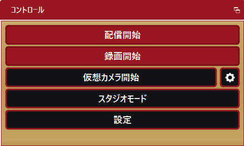
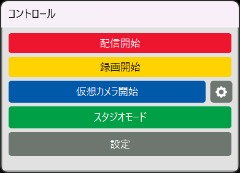
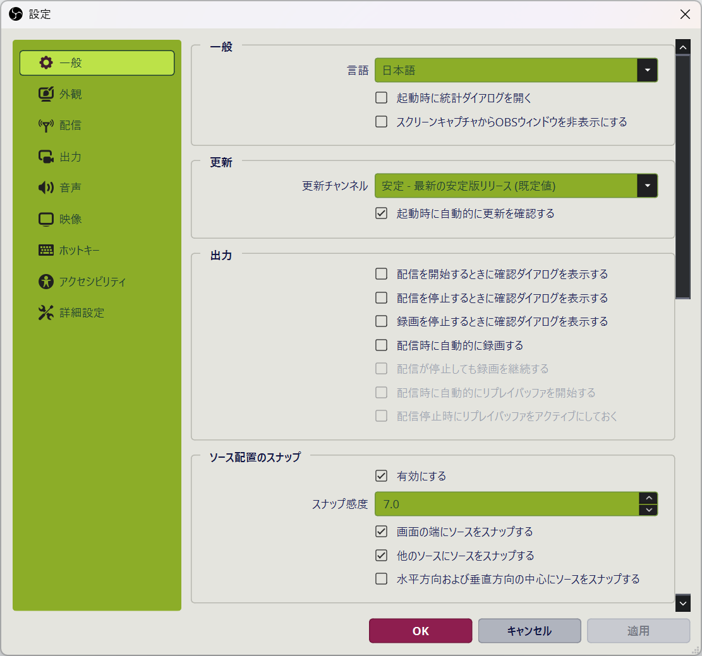
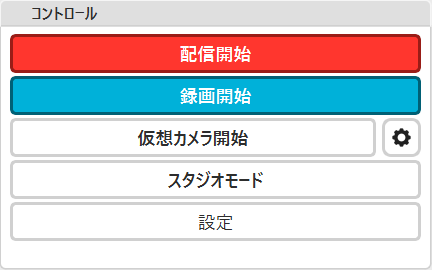
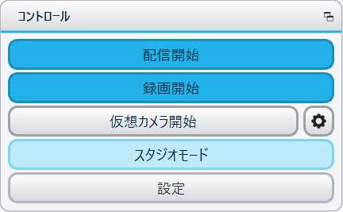
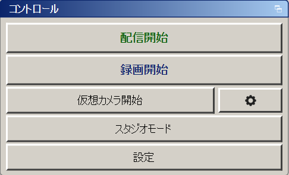
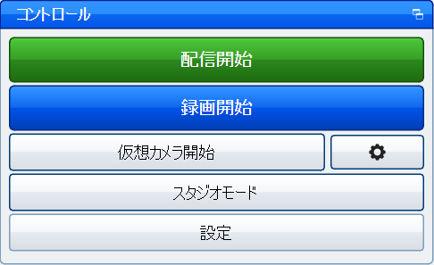
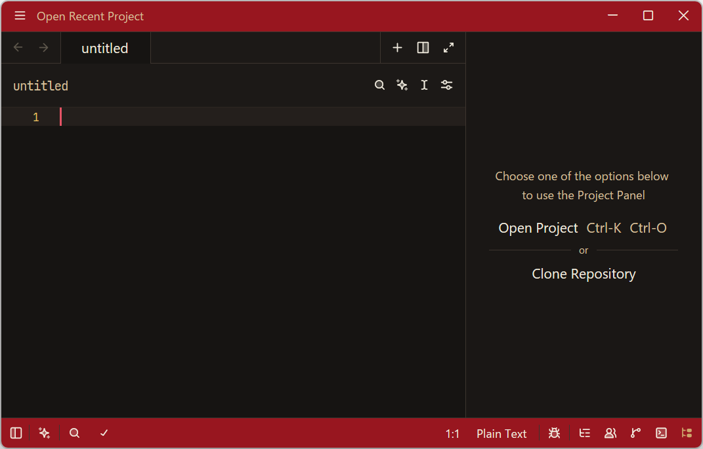
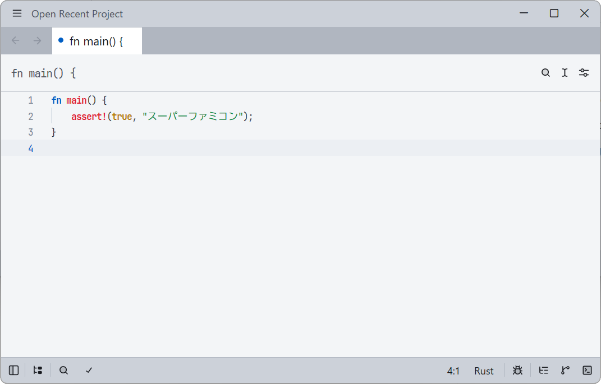
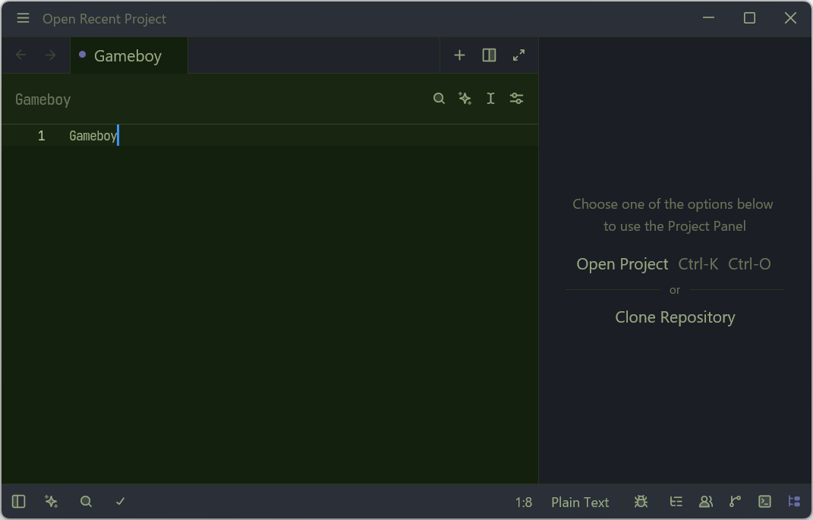

# retro-app-themes 🎮

**Famicom / Super Famicom / Game Boy / NES / SNES / Wii / Switch / Windows Classic / Windows XP Luna** — レトロハード & クラシックOSの配色を再現する、**OBS Studio・Zed 用テーマ集**

*Retro console & classic Windows color themes for **OBS Studio** and **Zed** editor — Famicom, Super Famicom, Game Boy, NES, SNES, Wii, Switch, Windows 98/2000 Classic, Windows XP Luna.*


ファミコン・スーファミ・ゲームボーイ・Wii・Switch・Windows Classic・Windows XP Luna の実機カラーパレットとデザイン言語を忠実に再現した、クリエイター＆エンジニア向けのテーマコレクションです。ダークテーマに飽きた方、配信画面・エディタをレトロ・モダンゲーム機の雰囲気にしたい方へ。

> **キーワード**: OBS theme / OBS Studio テーマ / Zed theme / ファミコン / スーパーファミコン / ゲームボーイ / Wii / Switch / Windows XP / Windows 98 / レトロ / retro / pixel / Famicom / Game Boy

---

## 📸 プレビューギャラリー

### OBS Studio
| ファミリーコンピュータ | スーパーファミコン | ゲームボーイ | Nintendo Switch |
| :---: | :---: | :---: | :---: |
|  |  |  |  |

| Nintendo Wii | Windows Classic | Windows XP Luna |
| :---: | :---: | :---: |
|  |  |  |

### Zed エディタ
| ファミリーコンピュータ | スーパーファミコン | ゲームボーイ |
| :---: | :---: | :---: |
|  |  |  |

---

## ⚡ クイックスタート

```bash
git clone https://github.com/kjozk/retro-app-themes.git
cd retro-app-themes/obs-studio   # Zed は zed/
# Windows: install.bat  /  macOS・Linux: bash install.sh
```

---

## 🎨 対応アプリケーション一覧

各アプリケーションのフォルダー内に、テーマ本体・専用インストーラー・詳細ドキュメントが同梱されています。使いたいアプリケーションのディレクトリへ進んでインストールしてください。

| アプリケーション | 状態 | 収録テーマ | 詳細・インストール手順 |
| :--- | :---: | :--- | :--- |
| **OBS Studio** | ✅ 対応済み | ファミリーコンピュータ / スーパーファミコン / ゲームボーイ / NES / SNES / Wii / Switch / Windows Classic / Windows XP Luna | [OBS Studio テーマ詳細](obs-studio/README.md) |
| **Zed** | ✅ 対応済み | FC / SFC / GB / NES / SNES / Wii / Switch (Dark & Light・ブラー対応) | [Zed テーマ詳細](zed/README.md) |
| **VS Code** | 🚧 開発中 | Family Computer / Super Famicom / Gameboy | [VS Code テーマ詳細](vscode/README.md) |

---

## 🎮 テーマコンセプト & 特徴

### 1. ファミリーコンピュータ (Family Computer)
- **実機成型色の完全再現**: 懐かしく温かみのあるアイボリー成型色のベース背景。
- **伝統のえんじ色（マルーン）**: アクセント、ヘッダー、主要ボタンに採用。
- **真鍮・金プレートのヘアライン再現**: コントローラー前面のゴールドを各UIの選択ハイライトや強調ボタンに反映。
- **IIコン（マイク）モチーフ**: 音声ミキサーのチャンネルストリップやノブに、IIコンの意匠を忠実に再現。
- **高コントラスト文字**: 白・アイボリー背景でも視認性を一切犠牲にしない、くっきりとした文字コントラスト。

### 2. スーパーファミコン (Super Famicom)
- **実機成型色のライトグレー**: 青み・紫みをほんのり含んだクールな本体色。
- **2トーン・スレートグレー**: カセットスロットやイジェクト・POWER/RESETスイッチの重厚なグレーをプライマリーカラーに統一。
- **ABXY 4色ボタンアクセント**: 赤・黄・青・緑の象徴的な発色と発光インジケーター（青色は特定機能のみに限定しノイズを防止）。

### 3. ゲームボーイ (Gameboy)
- **実機再現オリーブ液晶**: 初代ゲームボーイ（DMG-01）の象徴である4階調STN液晶のオリーブイエローグリーンを大胆にベース採用。
- **青紫ロゴ (`#393C9F`) & A/Bマゼンタ (`#9E285A`)**: アイコン、見出し、フォーカス枠線に実機パーツカラーを完全マッピング。
- **画面ベゼル 2トーンフレーム**: スレートグレーの画面枠と成型色オフホワイトのタブバーで、ハードウェアの没入感を再現。

### 4. Windows Classic (Windows 95/98/2000/XPクラシック)
- **実機完全再現の 3D ベベル**: 角丸なし（0px）の完全スクエアUIと、光（白）と影（グレー・黒）による 3D Raised / Sunken ベベルを全ウィジェットで再現。
- **伝統のアクティブ濃紺グラデーション**: ドックタイトルバーやリスト選択時に、クラシック特有のディープネイビー〜シアン（`#0A246A` → `#A6CAF0`）をマッピング。
- **押し込み（Sunken）フィール**: ボタン押下時にベベルが反転し、テキストが右下に1px沈み込むクラシックな押し心地。
- **クラシックスクロールバー & スライダー**: 16px幅の立体スクロールバーと、ホームベース型（五角形）スライダーノブを搭載。

### 5. Windows XP Luna
- **Luna ロイヤルブルー光沢**: ドックタイトルバーや主要ボタンに、XPの象徴である光沢ロイヤルブルーのグラデーションを採用。
- **スタートボタン風エメラルドグリーン**: 「配信開始」ボタンなどに、XPスタートボタンを彷彿とさせる鮮やかなアクセントを配置。
- **クリーン・ペールシルバー**: 現代のディスプレイに合わせて黄ばみを排した、爽やかなペールシルバーグレー（`#EEF1F4`）を基調色に設定。
- **XP スカイブルースクロールバー**: 水色円柱グラデーションのつまみと上下矢印ボタンを完全再現。

### 6. NES (Nintendo Entertainment System / 北米版)
- **北米版 NES の実機カラー**: ライトグレーの本体色と黒のコントローラー、赤のアクセントを再現（日本版ファミコンのアイボリー × えんじ色とは別配色）。
- **FC をベースに無彩色化**: 暖色系の成型色・金プレートをグレーへ置換し、赤はそのまま操作ボタンの強調色に使用。

### 7. SNES (Super Nintendo Entertainment System / 北米版)
- **北米版 SNES の実機カラー**: ニュートラルなライトグレー本体と、ラベンダー/パープルのボタン配色を再現（日本版スーファミの ABXY 4 色とは別配色）。
- **SFC をベースに再配色**: 青みのあるスレートを無彩色化し、青系アクセントをパープルへ置換。

### 8. Wii (Nintendo Wii)
- **白いボディ × 水色 × シルバー**: Wii 本体の白い成型色を土台に、ロゴ／ディスクスロットの水色（`#22B2E9`）をアクセント、スタンドのシルバーを構造色に採用。
- **Wii メニュー風の丸いタイル UI**: 角丸を大きめにし、白→シルバーのグラデーションと水色の下線でチャンネル画面を再現。
- **視認性重視**: 水色の塗りの上は濃紺文字、水色の文字が必要な箇所は深い水色（`#136185`）に分離。

### 9. Nintendo Switch (Dark & Light)
- **公式 2 テーマの完全同期**: Nintendo Switch システム UI のミニマルなマットチャコール（Dark: `#2D2D2D`）およびマットオフホワイト（Light: `#EBEBEB`）を基調とし、Light では決定ブルー（`#2052FF`）、Dark ではシアン（`#00D2F3`）を象徴色に設定。
- **キャレット外枠と選択インジケーターの多層分離**: 実機設定画面の操作感を再現し、外側に 2px キャレットハイライト枠線、内側に独立した縦バーインジケーターを配置して衝突を防止。
- **実機電源メニュー準拠トグルボタン**: ベタ塗りを廃止し、深みのある黒背景＋シアン/ブルー枠線＋純白文字により 16:1 以上の高い視認性を両立。
- **丸型ノブスライダー & ネオンカラー**: 細身のカプセル型トラックと直径 16px の純白円形ノブ、Joy-Con やホーム丸アイコンにインスパイアされたカラーマッピング。

---

## 🚀 インストール手順 (個別インストール)

本リポジトリは、ご利用のアプリケーションごとに個別フォルダー内でインストールを完結できる構成になっています。

### OBS Studio へのインストール
1. `obs-studio/` ディレクトリに移動します。
2. OS に合わせたインストーラーを実行します：
   - **Windows**: `install.bat` をダブルクリック（または PowerShell で `.\install.ps1` を実行）
   - **macOS / Linux**: ターミナルで `bash install.sh` を実行
3. 詳細は [OBS Studio テーマ詳細 (obs-studio/README.md)](obs-studio/README.md) をご覧ください。

### Zed エディタへのインストール
1. `zed/` ディレクトリに移動します。
2. OS に合わせたインストーラーを実行します：
   - **Windows**: `install.bat` をダブルクリック（または PowerShell で `.\install.ps1` を実行）
   - **macOS / Linux**: ターミナルで `bash install.sh` を実行
3. 詳細は [Zed テーマ詳細 (zed/README.md)](zed/README.md) をご覧ください。

---

## 📂 ディレクトリ構成

```text
retro-app-themes/
├── obs-studio/                  # OBS Studio 向けテーマ
│   ├── themes/
│   │   ├── Yami_SuperFamicom.ovt
│   │   ├── Yami_FamilyComputer.ovt
│   │   ├── Yami_Gameboy.ovt
│   │   ├── Yami_NES.ovt
│   │   ├── Yami_SNES.ovt
│   │   ├── Yami_Wii.ovt
│   │   ├── Yami_Switch_Dark.ovt
│   │   ├── Yami_Switch_Light.ovt
│   │   ├── Yami_WindowsClassic.ovt
│   │   ├── Yami_Luna.ovt
│   │   └── classic/             # クラシックスライダーSVGアセット
│   ├── install.bat              # OBS専用インストーラー (Win)
│   ├── install.ps1
│   ├── install.sh               # OBS専用インストーラー (macOS / Linux)
│   └── README.md
│
├── zed/                         # Zed エディタ向けテーマ
│   ├── themes/
│   │   ├── super-famicom.json
│   │   ├── family-computer.json
│   │   ├── nes.json
│   │   ├── snes.json
│   │   ├── wii.json
│   │   ├── switch.json
│   │   └── gameboy.json
│   ├── install.bat              # Zed専用インストーラー (Win)
│   ├── install.ps1
│   ├── install.sh               # Zed専用インストーラー (macOS / Linux)
│   └── README.md
│
├── docs/                        # 品質ガイドライン & 機種別詳細設計書
│   ├── ISSUES.md                # 課題管理簿 (Issue Tracker)
│   ├── THEME_REVIEW_GUIDELINES.md
│   └── designs/                 # 各ハードウェア・OS別詳細設計書アーカイブ
│       ├── README.md            # 機種別設計書インデックス
│       ├── gameboy.md
│       ├── famicom_super_famicom.md
│       ├── nes_snes.md
│       ├── nintendo_wii.md
│       ├── nintendo_switch.md
│       ├── windows_classic.md
│       └── windows_xp_luna.md
│
├── .agents/skills/              # 汎用設計・開発・検証スキル（機種非依存）
│   ├── obs-theme-authoring/
│   ├── retro-ui-metaphor-design/
│   ├── theme-review-guidelines/
│   ├── qt-stylesheet-troubleshooting/
│   ├── zed-theme-authoring/
│   └── powershell-scripting/
│
├── vscode/                      # VS Code 向けテーマ（開発準備中）
│   └── README.md
│
├── screenshots/                 # プレビュー画像
│   ├── obs/
│   │   ├── fc_preview.png
│   │   ├── sfc_preview.png
│   │   ├── gb_preview.png
│   │   ├── switch_preview.png
│   │   ├── wii_preview.png
│   │   ├── windows_preview.png
│   │   └── luna_preview.png
│   └── zed/
│       ├── fc_preview.png
│       ├── sfc_preview.png
│       └── gb_preview.png
│
├── .gitignore
├── LICENSE
└── README.md                    # 総合ポータル README
```

---

## 🛠️ テーマ開発・品質レビューガイドライン

新しいテーマの追加や既存テーマの改修にあたり、実機メタファーの再現性と高品質な UI/UX（アクセシビリティ・密度連動・リフロー防止）を保証するための包括的なレビュー観点をまとめています。

- 📌 [課題管理簿 (Issue Tracker)](docs/ISSUES.md) - 機能要望、UI/UX 改善課題、および既知の課題一覧
- 📋 [テーマ品質レビュー基準 & レビュー観点ガイドライン](docs/THEME_REVIEW_GUIDELINES.md)
  - **コントラスト & 視認性**: WCAG AA/AAA 準拠、白背景上の水色・黄色対策、未選択アイコンの同化防止
  - **実機メタファー設計**: 成型色と印字・ロゴ色の厳格分離、実機パレット階層
  - **OBS Studio 特有ルール**: コントロールボタン枠線 2px 固定（リフロー防止）、--obsPadding 動的変数による密度連動
  - **Zed エディタ特有ルール**: element.selected の半透明化（透明黒 #00000000 排除）、シンタックス階層
  - **インストーラー整合性**: PowerShell スクリプトの UTF-8 with BOM 厳守

### 📐 機種別詳細設計書 (Design Specifications)

各テーマの実機カラーパレット、ピクセル測定値、マテリアル意匠、および実装マッピングをまとめた詳細設計書です。

- 🎮 [Gameboy (DMG-01) テーマ詳細設計書](docs/designs/gameboy.md)
- 🎮 [ファミリーコンピュータ & スーパーファミコン テーマ詳細設計書](docs/designs/famicom_super_famicom.md)
- 🎮 [NES & SNES (北米版コンソール) テーマ詳細設計書](docs/designs/nes_snes.md)
- 🎮 [Nintendo Wii テーマ詳細設計書](docs/designs/nintendo_wii.md)
- 🎮 [Nintendo Switch テーマ詳細設計書](docs/designs/nintendo_switch.md)
- 💻 [Windows Classic (98/2000) テーマ詳細設計書](docs/designs/windows_classic.md)
- 💻 [Windows XP Luna テーマ詳細設計書](docs/designs/windows_xp_luna.md)

---

## 📜 ライセンス

本リポジトリ内のコードおよびテーマ定義は **GNU General Public License v2 (GPLv2)** の下で公開されています。詳細は [LICENSE](LICENSE) をご覧ください。

- **著作権**:
  - オリジナルの OBS Yami テーマおよび Zed テーマスキーマの著作権は、各プロジェクトおよびその貢献者に帰属します。
  - レトロハードウェア再現テーマのカラーパレット定義、スタイリング、カスタムコードの著作権は kjozk およびコントリビューターに帰属します。
- 任天堂の各ハードウェア名称および意匠は任天堂株式会社の商標または登録商標です。
- Microsoft、Windows、Windows XPは米国Microsoft Corporationの米国およびその他の国における登録商標または商標です。
- 本プロジェクトはファンによる非公式のオマージュテーマです。
