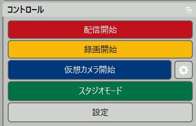

# OBS Studio Custom Theme: Super Famicom (Yami Based)

このリポジトリーは、OBS Studioの公式テーマ「Yami」をベースに、スーパーファミコン（SFC）のカラーパレットを採用したカスタムテーマを公開・配布するためのものです。

## 特徴
- **SFCカラーパレット**: SFCの配色（A/B/X/Yボタンの色など）を採用。
- **高コントラスト**: ライトテーマ気味の配色ながら、文字の視認性を確保。
- **独自アイコン**: SFC風のチェックボックスなどのカスタムアセットを同梱。

## インストール方法

1. このリポジトリーをダウンロード（またはクローン）します。
2. 以下のファイルをOBS Studioのテーマフォルダーにコピーします。
   - `Yami_SuperFamicom.ovt`
   - `sfc/` （フォルダーごと）

> [!NOTE]
> 本テーマはOBS Studioに内蔵されている「Yami」テーマを拡張する形で動作します。そのため、別途 `Yami.obt` などをコピーする必要はありません。

### テーマフォルダーの場所

OSごとに以下のパスにコピーしてください。

- **Windows**: `%PROGRAMFILES%\obs-studio\data\obs-studio\themes\`
  - エクスプローラーのアドレスバーに上記を貼り付けて移動できます。

### 適用方法
1. OBS Studioを起動（既に起動している場合は再起動）します。
2. **設定 > 外観 > テーマ** から 「Super Famicom」 を選択します。
   ※設定の場所はOBSのバージョンにより「一般」または「外観」にあります。

## ライセンスと再配布について

本テーマは **GNU General Public License v2 (GPLv2)** の下で公開されています。詳細は [LICENSE](LICENSE) ファイルを参照してください。

- **ベーステーマ**: 本テーマは [OBS Studio](https://github.com/obsproject/obs-studio) プロジェクトに含まれる「Yami」テーマに基づいています。
- **著作権**:
  - オリジナルの Yami テーマおよびアセットの著作権は OBS Project およびその貢献者に帰属します。
  - カスタマイズ部分（`Yami_SuperFamicom.ovt` および `sfc/` 内の変更）の著作権は kjozk および Antigravity に帰属します。
- **再配布**: GPLv2 ライセンスの規定に従い、本テーマの改変および再配布が可能です。再配布の際は、このライセンス条件を継承し、適切なクレジット表記を行ってください。

## 免責事項
本テーマの使用により生じた損害等について、制作者は一切の責任を負いません。

---
Created by kjozk & Antigravity
Based on OBS Studio Yami Theme.
