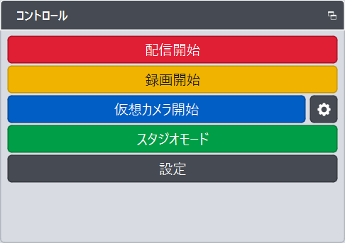
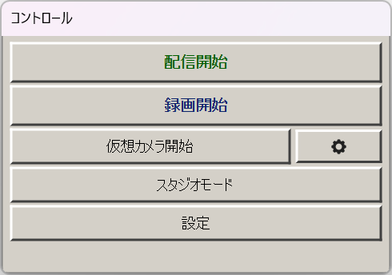

# OBS Studio Themes: レトロハードウェア & クラシックOS コレクション

OBS Studio 公式のライトテーマ「Yami (Light)」をベースに、任天堂の伝説的名機（**ファミリーコンピュータ**、**スーパーファミコン**、**ゲームボーイ**）およびクラシックOS（**Windows Classic**、**Windows XP Luna**）の実機カラーパレットとデザイン言語を忠実に再現したカスタムテーマコレクションです。

| ファミリーコンピュータ | スーパーファミコン | Windows Classic |
| :---: | :---: | :---: |
|  |  |  |

---

## 収録テーマ

### 1. ファミリーコンピュータ (Family Computer)
- **実機再現カラー**: 温かみのあるアイボリー成型色（ベース背景）に、伝統のえんじ色（マルーン）のドックヘッダーや主要ボタン。
- **真鍮・金プレートアクセント**: コントローラー前面のヘアライン真鍮を思わせるリッチゴールド（録画ボタン、リスト・サイドバーの選択ハイライト）。
- **IIコン（マイク）モチーフ完全再現**: 音声ミキサーのチャンネルストリップやノブに、IIコンの意匠を反映。

### 2. スーパーファミコン (Super Famicom)
- **実機再現カラー**: クールなライトグレーの本体色、イジェクト・POWER/RESETスイッチのスレートグレー（タブやOKボタン、選択ハイライト）。
- **ABXY 4色ボタン**: コントロールボタンに赤・黄・青・緑の象徴的な配色と発光インジケーターを採用。

---

### 3. ゲームボーイ (Gameboy) - `Yami_Gameboy.ovt`
- **本体オフホワイト成型色**: 初代ゲームボーイ（DMG-01）のボディプラスチックをベース背景に採用。
- **A/Bボタン小豆色 & 青紫ロゴ**: 「配信開始」ボタンや主要OKボタンに実機 A/B ボタンの**小豆色（`#8e1e4f`）**、「録画開始」ボタンやフォーカス枠線に**青紫ロゴカラー（`#393c9f`）**を配置。
- **実機液晶オリーブグリーン**: 「仮想カメラ開始」ボタンや音声ミキサーの通常レベルメーターに**初代液晶オリーブ（`#8c9e5b`）**を採用。
- **液晶画面プレビューフレーム**: プレビュー周囲に液晶の最深緑黒（`#14200e`）を敷き、まるで実機ゲームボーイの画面の中にプレビュー映像が投影されているかのようなギミックを演出。

### 4. Windows XP Luna - `Yami_Luna.ovt`
- **Luna ロイヤルブルー光沢**: ドックタイトルバーや録画ボタンに、XPの象徴である光沢ロイヤルブルーを採用。
- **XPスタートボタン風グリーン**: 配信開始ボタンにXPの「スタート」ボタンを彷彿とさせる鮮やかなエメラルドグリーンを採用。
- **クリーン・ペールシルバー調整**: 現代のディスプレイに合わせて、黄ばみのない爽やかなペールシルバーグレー（`#EEF1F4`）を基調色に設定。
- **実機スカイブルースクロールバー**: 水色円柱グラデーションのつまみと矢印ボタンを完全再現。

### 5. Windows Classic - `Yami_WindowsClassic.ovt`
- **Windows 95/98/2000/XPクラシック完全再現**: 角丸なし（0px）の完全スクエアUIと、光と影の2色ベベル（3D Raised / Sunken）を採用。
- **伝統の濃紺グラデーション**: ドックタイトルバーやリスト選択時に、クラシック特有のディープネイビー〜シアン（`#0A246A` → `#A6CAF0`）をマッピング。
- **押し込み（Sunken）演出**: ボタン押下時にテキストが右下に1px沈み込むクラシックな押下フィールを再現。
- **クラシック立体スクロールバー**: 四角い立体ベベルつまみと矢印ボタン（16px）を搭載。

## インストール方法

### 自動インストール（推奨）

- **Windows**:
  - `obs-studio/` 内の **`install.bat` をダブルクリック**（または PowerShell から `.\install.ps1` を実行）します。
- **macOS / Linux**:
  - ターミナルで `obs-studio/` に移動し、以下を実行します：
    ```bash
    bash install.sh
    ```

### 手動インストール

`themes/` 内の `.ovt` ファイルを、各OSの対応フォルダーにコピーしてください。

- **Windows**: `%APPDATA%\obs-studio\themes\`
- **macOS**: `~/Library/Application Support/obs-studio/themes/`
- **Linux**: `~/.config/obs-studio/themes/`  
  ※Flatpak版: `~/.var/app/com.obsproject.Studio/config/obs-studio/themes/`

---

## 適用方法
1. OBS Studio を起動（起動中の場合は再起動）します。
2. メニューの **設定 > 外観 > テーマ**（または **一般 > テーマ**）を開きます。
3. 一覧から目的のテーマを選択し、「適用」をクリックします：
   - **Family Computer**（ファミリーコンピュータ）
   - **Super Famicom**（スーパーファミコン）
   - **Gameboy**（ゲームボーイ）
   - **Windows Classic**（Windows 95/98/2000/XP クラシック）
   - **Windows XP Luna**（Windows XP Luna ブルー）
