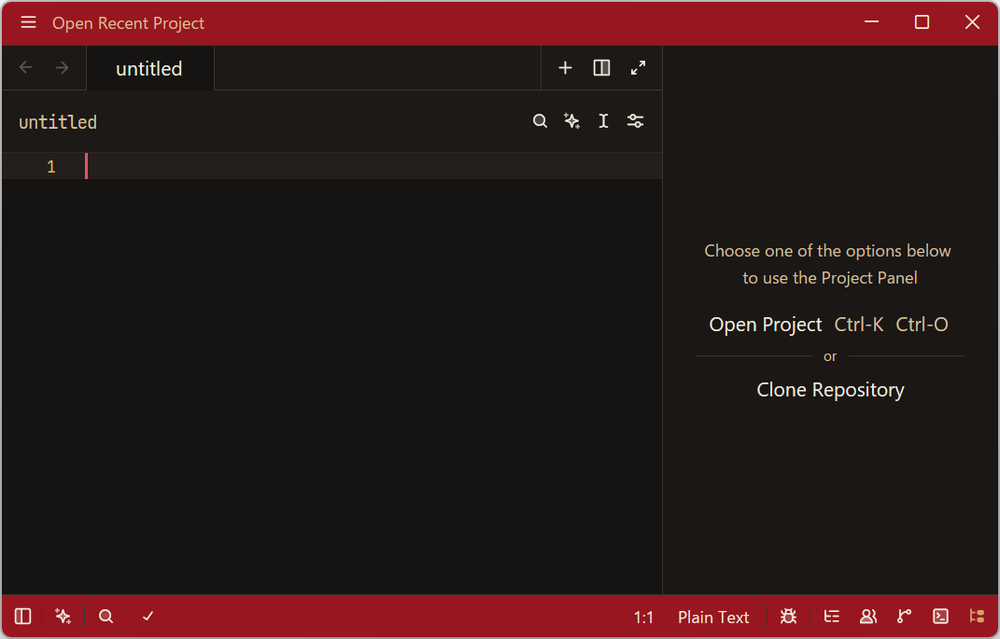
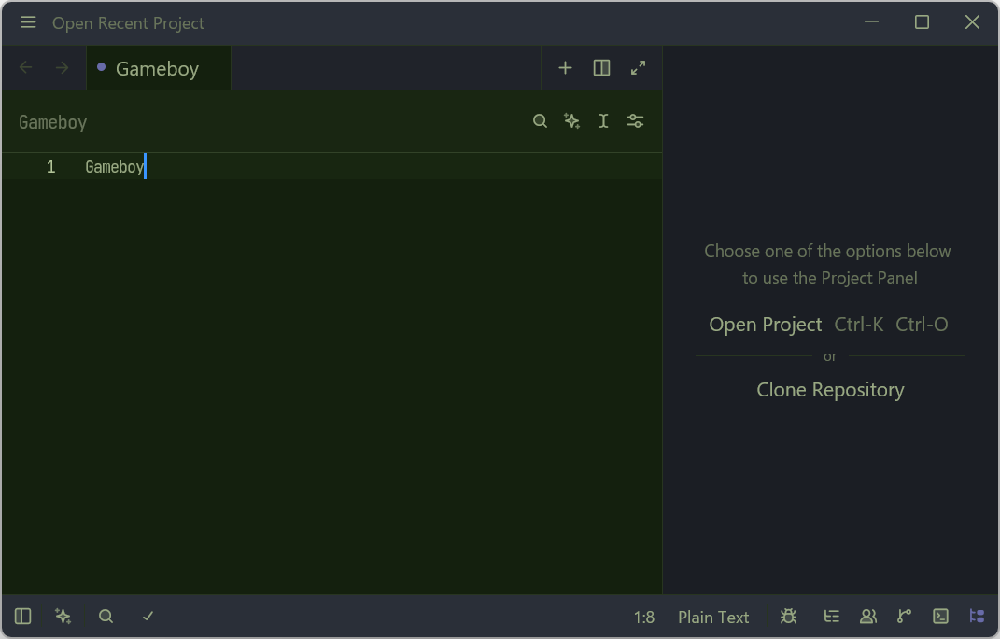

# Zed Themes: ファミリーコンピュータ / スーパーファミコン / ゲームボーイ

次世代高性能エディタ [Zed](https://zed.dev/) 向けのカスタムテーマです。  
任天堂の伝説的名機である **ファミリーコンピュータ（FC）**、**スーパーファミコン（SFC）**、および **ゲームボーイ（GB）** の実機カラーパレットとデザイン言語を忠実に落とし込んでいます。

| ファミリーコンピュータ | ゲームボーイ |
| :---: | :---: |
|  |  |

---

## 収録テーマ

### 1. ファミリーコンピュータ (Family Computer)
- **実機再現アイボリー**: 本体の成型色（ベース背景）に温かみのあるクラシックなトーン。
- **えんじ色 & 真鍮ゴールド**: アクティブ要素やタブのハイライトに伝統のえんじ色と真鍮ゴールド。
- **構文ハイライト**: 視認性に優れたコントラストとレトロハードの調和。

### 2. スーパーファミコン (Super Famicom)
- **実機再現ライトグレー**: スーファミ本体のクールなライトグレーとスレートグレーの2トーン構成。
- **ABXY 4色アクセント**: 赤・黄・青・緑をコードシンタックスやステータス表示のアクセントカラーとして採用。
- **[Blurred] / 通常バリアント**: 背景ブラー透過や通常モードに対応。

---

### 3. ゲームボーイ (Gameboy)
- **実機再現オリーブ液晶**: 初代ゲームボーイ（DMG-01）のSTN液晶グリーン（`#8C9E5B`）をベースに採用。
- **青紫ロゴ & マゼンタボタン**: ロゴの青紫色（`#393C9F`）と A/B ボタンのマゼンタ（`#9E285A`）をアクセントに配置。
- **画面ベゼルフレーム**: スレートグレーの画面枠と、本体成型色のオフホワイトタブバー。
- **[Blurred] / 通常 / Dark バリアント**: 液晶反転・バックライト解釈の Dark モードも完備。

## インストール方法

### 自動インストール（推奨）

- **Windows**:
  - `zed/` 内の **`install.bat` をダブルクリック**（または PowerShell から `.\install.ps1` を実行）します。
- **macOS / Linux**:
  - ターミナルで `zed/` に移動し、以下を実行します：
    ```bash
    bash install.sh
    ```

### 手動インストール

`themes/` 内の `.json` ファイルを、各OSのテーマフォルダーにコピーしてください。

- **Windows**: `%APPDATA%\Zed\themes\`
- **macOS / Linux**: `~/.config/zed/themes/`（または `$XDG_CONFIG_HOME/zed/themes/`）

---

## 適用方法
1. Zed を開きます。
2. コマンドパレット（`Ctrl+Shift+P`）を開き、`theme: select`（または `Ctrl+K Ctrl+T`）を入力します。
3. 一覧から以下のいずれかを選択します：
   - **ファミリーコンピュータ**（または半透明背景の **ファミリーコンピュータ [Blurred]**）
   - **スーパーファミコン**（または半透明背景の **スーパーファミコン [Blurred]**）
   - **ゲームボーイ**（または半透明背景の **ゲームボーイ [Blurred]**）
